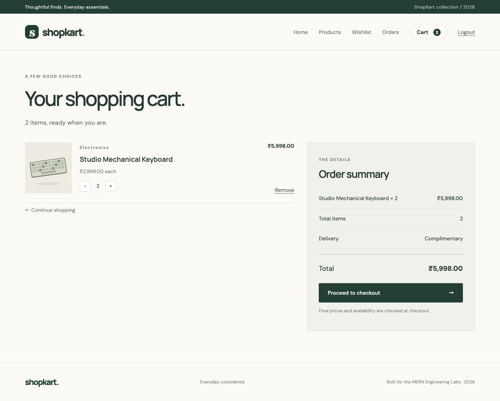

# ShopKart — MERN Engineering Labs 01–06

A full-stack shopping application built with MongoDB, Express, React and Node.js. It combines all six [ShopKart lab specifications](https://github.com/mrinal1224/Lab-2029-Problem-Statements) into one project.

**Journey:** register → log in → browse/search/filter → save to wishlist → manage cart → shipping details → Razorpay Test Mode checkout → server verification → order history.

## Start here

You need **Node.js 22.12+ (Node 24 recommended)**, a MongoDB Atlas database, and Razorpay **Test Mode** keys for checkout.

```bash
git clone https://github.com/yourfriendlyneighbourhoodprogrammer/shopkart-mern-labs.git
cd shopkart-mern-labs
npm ci
cp backend/.env.example backend/.env
```

Fill `backend/.env` following the [step-by-step setup guide](docs/SETUP.md). Then:

```bash
npm run seed
npm run dev
```

Open **http://localhost:5173**, register an account, then log in. There is no hardcoded login. The sample catalogue is seeded into MongoDB, not hardcoded into the frontend.

**MongoDB credentials and Razorpay keys are deliberately not included.** Browse/auth/wishlist/cart work without payment keys; checkout gives an explicit setup error until Test Mode keys are added. A real Razorpay Test Mode payment still needs to be completed with your own account after setup.



## Included features

- Customer registration, bcrypt password hashing, JWT in an HttpOnly cookie, protected profile, logout, and change-password bonus.
- API-driven catalogue, case-insensitive search, category filtering, price sorting bonus, product details, local product illustrations.
- Persistent wishlist with Product references, duplicate prevention and local page state.
- Persistent cart with React Context, quantity limits, live navbar count, derived totals and deleted-product handling.
- Validated shipping form, latest-price/stock checks and immutable purchase-time snapshots.
- Razorpay Test Mode order creation, HMAC signature validation, provider payment-status verification, and transactional order confirmation/cart clearing.
- Order ownership checks, payment retry support, confirmation page and history.
- Responsive layouts and loading, empty, error, retry and action-progress states.

## Project structure

```text
backend/
  config/          Razorpay configuration
  controllers/     API behavior
  models/          Customer, Product, Order
  routes/          Endpoint definitions
  middlewares/     Cookie/JWT authentication
  utils/           Token, validation and errors
  data/            Sample catalogue
  scripts/         Non-destructive seeding
  tests/           API integration tests
frontend/
  public/images/   Original SVG product illustrations
  src/
    pages/         Authentication, shopping and checkout screens
    components/    Navbar, product cards, summary and feedback
    context/       Session and global cart state
    hooks/         Fetch lifecycle hook
    services/      API calls, payment integration and cart math
docs/
  SETUP.md
  LAB-CHECKLIST.md
  API.md
  WALKTHROUGH.md
  TESTING.md
  ShopKart.postman_collection.json
```

The Lab 01 model is called `Customer`; it is the same user entity that later lab examples call `User`. Its relationships reference the `Customer` model consistently.

## Commands

| Command | Purpose |
|---|---|
| `npm ci` | Install locked dependencies |
| `npm run seed` | Insert missing sample products; preserve existing data |
| `npm run dev` | Run frontend and backend together |
| `npm test` | API tests using a disposable MongoDB replica set |
| `npm run test:ui` | Cart calculation tests |
| `npm run build` | Build the React application |
| `npm run check` | Run both test suites and build |
| `npm start` | Run the backend with `backend/.env` |

## Evaluation and preparation

- [Lab-by-lab requirement map](docs/LAB-CHECKLIST.md)
- [API endpoints and Postman collection](docs/API.md)
- [Testing results and final manual checks](docs/TESTING.md)
- [Implementation walkthrough and viva preparation](docs/WALKTHROUGH.md)

This is a lab implementation, not a live-money commerce deployment. Product creation is open as explicitly allowed in Lab 03. Fulfilment, inventory reservations, refunds, webhooks and administrative order progression are outside the required implementation. Stock is validated when adding/updating cart items and creating a pending order; this project does not implement warehouse stock deduction or reservation.

AI assistance was used for implementation, documentation and testing. Review the code and follow your course's AI-use requirements; the compulsory viva still requires you to understand and explain the implementation.
